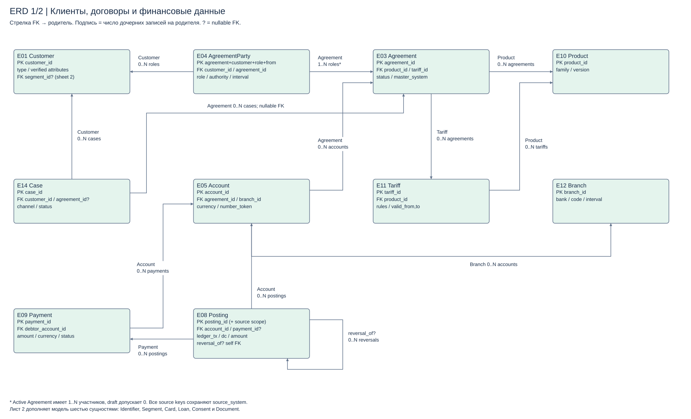
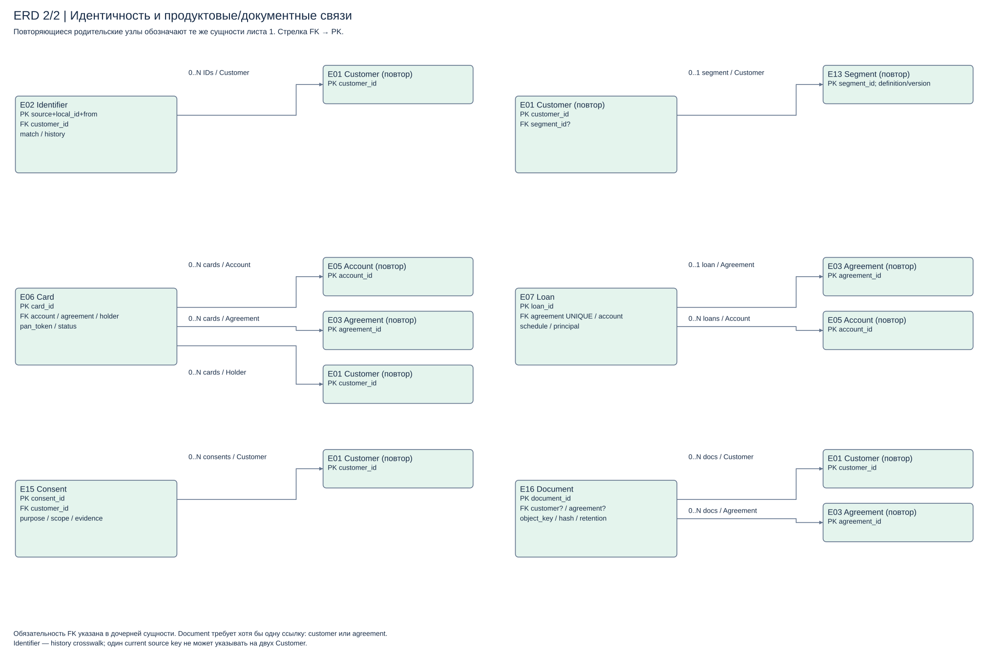

# Задание 1. Данные и хранилища

Определены 16 сущностей. «Транзакция» уточнена до бухгалтерской проводки, платёж сохранён отдельным поручением. Универсальный «справочник» раскрыт в продукты, тарифы, отделения и сегменты; добавлены crosswalk, участник договора и согласие.

1. [Сущности и качество](entities.md)
2. [Логическая модель](logical-data-model.md)
3. [Классификация и защита](data-classification.md)
4. [Выбор хранилищ](storage-strategy.md)
5. [BIAN: 10 сопоставлений](reference-model.md)

[Редактируемая ERD](diagrams/logical-model.drawio). Технические keys и все кардинальности описаны в модели; стрелки читаются от FK к родителю.

[Лист 2 Draw.io](diagrams/logical-support.drawio): Identifier, Segment, Card, Loan, Consent и Document. Родители повторяются для читаемости и обозначают те же сущности.
