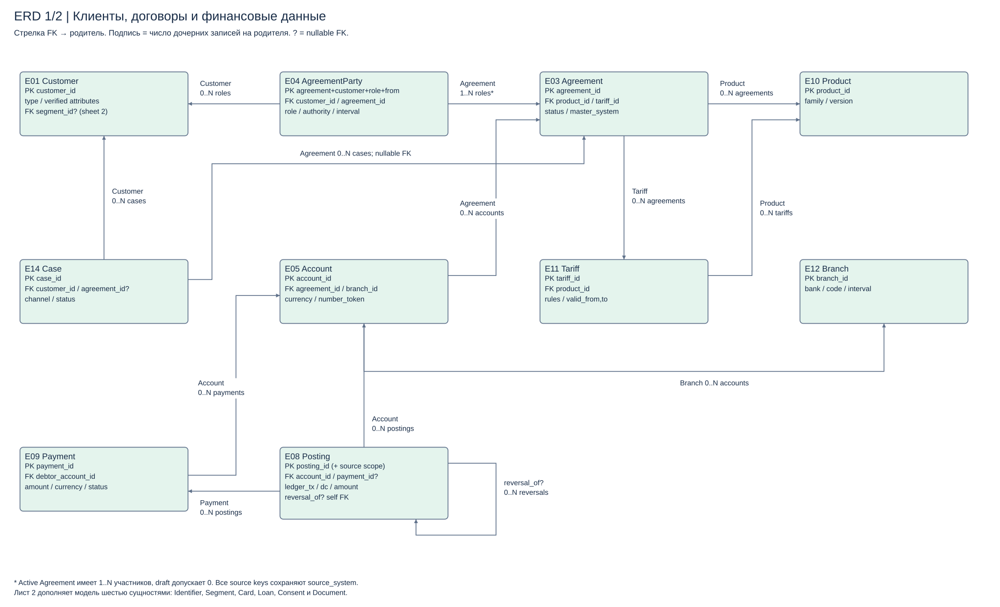
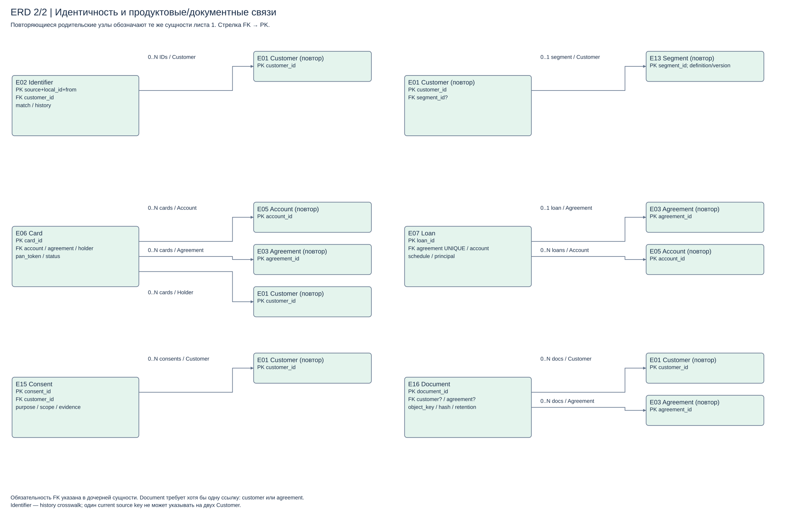

# Логическая модель

[Draw.io, лист 1](diagrams/logical-model.drawio) · [Лист 2: дополнительные связи](diagrams/logical-support.drawio).

Это общая логическая модель; физические таблицы распределены между мастерами Task2. Cross-system FK проверяет интеграция/DWH, общей транзакции всех систем нет.

## Ключи и кардинальности

PK большинства сущностей — одноимённый `<entity>_id`. Identifier PK = (source_system, source_customer_id, valid_from), уникальность действующего (source_system, source_customer_id). AgreementParty PK = (agreement_id, customer_id, role, valid_from). Обязательный FK допускает ровно одного родителя, nullable — ноль либо одного. На схеме подписи указывают число дочерних записей на родителя; направление стрелки FK → PK.

| Дочерняя запись → родитель | FK | Кардинальность / обязательность |
|---|---|---|
| Identifier → Customer | customer_id NOT NULL | Customer имеет 0..N crosswalk; каждая принятая запись источника имеет один current mapping |
| Customer → Segment | segment_id NULL | 0..1 сегмент у клиента, 0..N клиентов в сегменте; NULL до классификации |
| AgreementParty → Customer / Agreement | оба NOT NULL | Customer 0..N ролей; Agreement 1..N участников после активации; draft может иметь 0 |
| Agreement → Product / Tariff | оба NOT NULL для active | Product и конкретная версия Tariff имеют 0..N договоров; тариф принадлежит тому же product |
| Tariff → Product | product_id NOT NULL | У продукта 0..N версий тарифов |
| Account → Agreement / Branch | оба NOT NULL | У договора 0..N счетов, отделения 0..N счетов |
| Card → Account / Agreement / Customer | три NOT NULL | У каждого родителя 0..N карт; holder — держатель, права проверяются по AgreementParty |
| Loan → Agreement / Account | agreement_id NOT NULL UNIQUE; settlement_account_id NOT NULL | У договора 0..1 Loan; у счёта 0..N кредитов; кредитные учётные счета отражены дополнительно в Core |
| Posting → Account | account_id NOT NULL | Счёт 0..N проводок |
| Posting → Payment | payment_id NULL | Платёж 0..N проводок; комиссия/начисление может не иметь Payment |
| Posting → Posting | reversal_of NULL | Корректирующая запись ссылается на оригинал; оригинал 0..N корректировок с контролем полной суммы |
| Payment → Account | debtor_account_id NOT NULL | Счёт 0..N исходящих поручений; внешний получатель — reference, не вымышленный внутренний счёт |
| Case → Customer / Agreement | customer_id NOT NULL; agreement_id NULL | Клиент 0..N обращений; договор 0..N обращений; по договору проверяется право клиента |
| Consent → Customer | customer_id NOT NULL | Клиент 0..N согласий разных purpose/scope, без автоматического union разрешений |
| Document → Customer / Agreement | оба nullable, хотя бы один NOT NULL | Родитель 0..N документов; один файл может описывать клиента и договор |

В модели «операция» — ledger_transaction_id, объединяющий проводки. Сумма дебетовых и кредитовых проводок сверяется по каждой валюте внутри ledger_transaction_id; внешний FX состоит из сбалансированных валютных ног и технических счетов, а не сравнения чисел разных валют. Установленное правило не превращает Payment в Posting и не допускает повторной отправки платежа ради ремонта DWH.

## История и инварианты

В crosswalk valid_to NULL означает текущую связь; интервалы одной пары источника не перекрываются. Merge хранит решение, прежние ID и alias; unmerge создаёт новую версию и инициирует пересчёт зависимых витрин. FK в истории оценивается на business time, а не только на текущий Customer.

Закрытие договора — status/closed_at, а не физическое удаление проводок. Для справочников product/tariff/branch/segment используются версии с полуоткрытым интервалом [valid_from, valid_to). Тариф в договоре закреплён по версии. Финансовое исправление производится новой корректирующей проводкой; нормализация аналитики сохраняет source payload hash и версию преобразования.

Адреса, идентификационные документы, полномочия и доли сторон в production потребуют дополнительных таблиц. Здесь их атрибуты/refs показаны укрупнённо, чтобы сохранить границы учебного проекта; скрытая кардинальность «один клиент — один договор» не предполагается.
