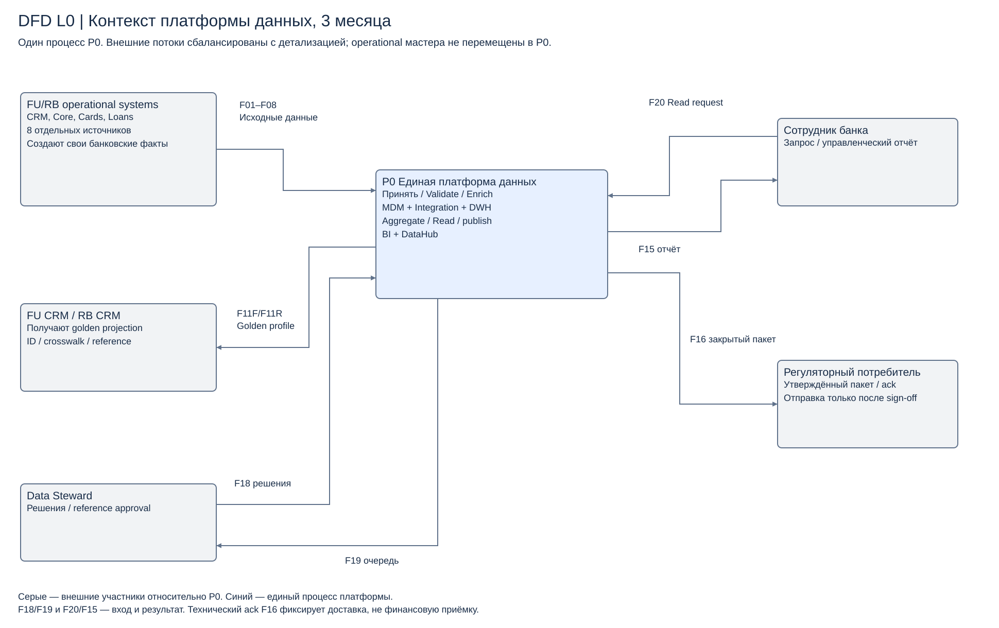
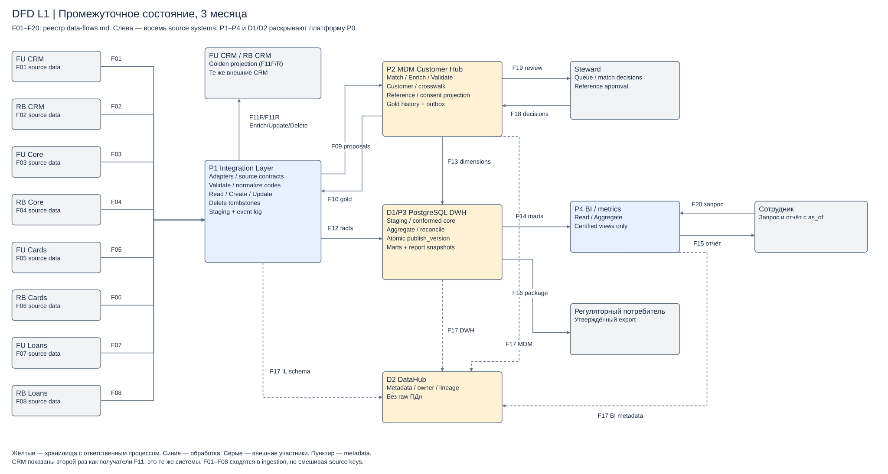

# Задание 2. Мастера и потоки на 3 месяца

[Мастера](master-systems.md) · [Владение и matching](data-ownership.md) · [Потоки](data-flows.md) · [Управление](data-flow-management.md) · [Зависимости](data-dependencies.md).

Контекст включает одну платформу P0 и внешние операционные системы/потребителей. Отдельная детализация показывает все восемь CRM/Core/Cards/Loans и целевые компоненты. Такое разделение сохраняет смысл контекстной DFD и одновременно раскрывает требуемый ландшафт.

[Контекст Draw.io](diagrams/context.drawio) · [Детальная Draw.io](diagrams/transition-dfd.drawio). Стрелки обозначают данные, а не сетевой вызов; ответ чтения и направление команды различаются в реестре потоков. Копии внутри платформы не являются новыми операционными мастерами.
