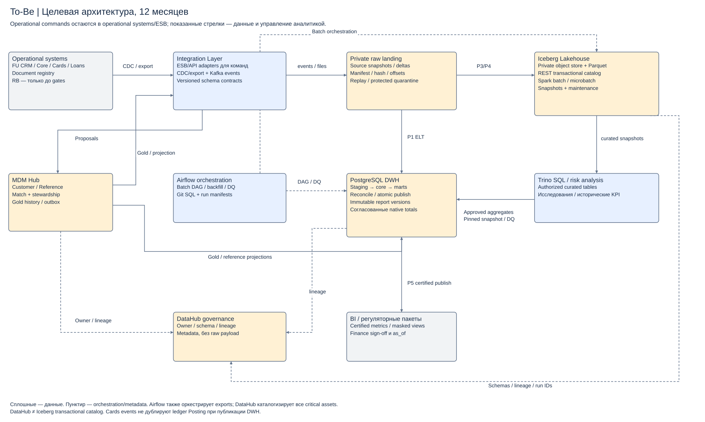

# Задание 3. Целевая платформа

Выбран гибрид: PostgreSQL DWH для управляемой отчётности плюс Iceberg Lakehouse для истории/событий; централизованная инфраструктура с доменными data products. Срок 3 месяца достигается без обязательного внедрения всего Lakehouse-стека.

[To-Be](target-data-architecture.md) · [Три варианта](architecture-options.md) · [DWH/Lakehouse](dwh-lakehouse.md) · [5 пайплайнов](data-pipelines.md) · [Звезда](analytical-model.md) · [4 продукта](data-products.md).

[Draw.io](diagrams/target.drawio). RB показан как временный источник исключений; его наличие после 12 месяцев означает незавершённый gate, а не второй целевой мастер.
