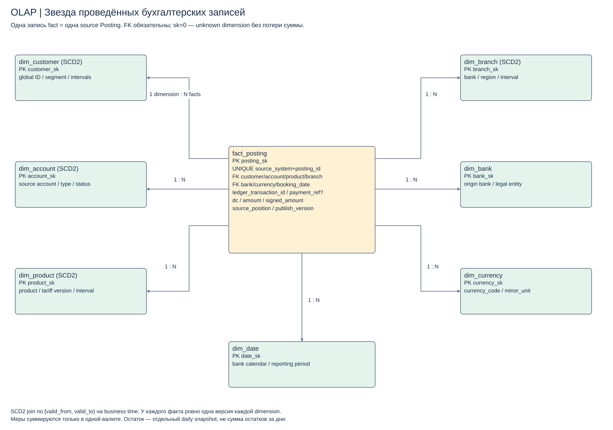

# Аналитическая модель: звезда бухгалтерских проводок

[Draw.io](diagrams/analytical-star.drawio). Область — финансовые обороты по клиентам/счетам/продуктам. **Зерно fact_posting: одна проведённая бухгалтерская запись source Core**, а не Payment, authorization или вся многопроводочная операция. Business key `(source_system, posting_id)` остаётся устойчивым; технический PK posting_sk. ledger_transaction_id группирует несколько проводок.

| Таблица | Ключи / атрибуты | Роль и историчность |
|---|---|---|
| fact_posting | posting_sk PK; source_system+posting_id UNIQUE; transaction_id; customer_sk, account_sk, product_sk, branch_sk, bank_sk, currency_sk, booking_date_sk FK; payment_ref?, reversal_of_ref?; dc, amount, signed_amount, source_position, publish_version | amount≥0 decimal(24,6), dc D/C; signed_amount = +amount для D, −amount для C. Это технический знак, не прибыль/расход. Исходная валюта и scale сохраняются |
| dim_customer | customer_sk PK, global_customer_id, party_type, segment_code, valid_from/to, recorded_at, match_version | SCD2, прямых контактов/документов нет; история merge/unmerge пересчитывается только новой версией витрины |
| dim_account | account_sk PK, canonical_account_id, source key, type, status, agreement_ref, valid_from/to | SCD2; номер token, история статуса/типа |
| dim_product | product_sk PK, product_code, family, tariff_version, valid_from/to | SCD2, закреплённые договорные условия; account mart получает продукт из действующего договора |
| dim_branch | branch_sk PK, bank_id, branch_code, region, valid_from/to | SCD2, реорганизации не меняют старый отчёт |
| dim_bank | bank_sk PK, source_bank, legal_entity_code | Статический справочник с версией юридической структуры; источники FU/RB не стираются после слияния |
| dim_currency | currency_sk PK, currency_code, minor_unit | Утверждённый reference; денежное округление по валюте |
| dim_date | date_sk PK, calendar_date, business_day_flag, reporting_period | Отдельный утверждённый банковский календарь; UTC event_time хранится в факте дополнительно |

Во всех FK присутствует unknown row (sk=0). Входы с неразрешённой размерностью не исчезают из сумм; completeness публикуется, а активные счета должны пройти mapping gate. As-of join использует банковское business time и неперекрывающийся интервал [valid_from,valid_to); ingestion time сохраняется отдельно. Поздняя dimension сначала заполняет unknown, затем выпускает новую версию затронутого среза. Нельзя соединять факт с несколькими текущими владельцами и умножать сумму: для общей клиентской аналитики выбирается одна согласованная reporting party role; остальные участники доступны через отдельный bridge без автоматического суммирования.

## Меры и ограничения суммирования

Дебетовый оборот = SUM(amount WHERE dc='D'); кредитовый = SUM(amount WHERE dc='C'), всегда GROUP BY currency. Net technical movement = SUM(signed_amount), но знак экономического остатка зависит от типа счёта. Для остатка используется отдельный `fact_account_daily_balance` с зерном account+bank_date+currency; balance полуаддитивен: можно складывать счета одной валюты на одну дату, нельзя складывать дни. Opening+movements с правилом знака account_type сверяется с closing balance Core.

Количество проводок не равно количеству операций. Для количества операций используется COUNT DISTINCT (source_system, ledger_transaction_id) после согласования внутреннего/межбанковского business reference. Общебанковский оборот внутренних переводов не получается простым сложением дебета и кредита всех счетов: Finance задаёт scope клиентских/технических счетов и правило внутренних переводов. Для cross-bank транзакции два origin ledger факта не схлопываются по совпавшим суммам; отдельный business linkage позволяет считать клиентское событие один раз в выделенной метрике.

Пересчёт в отчётную валюту — отдельная measure/report: amount_native × approved_fx_rate(booking_date,currency,rate_type,rate_version), с явным округлением и rate_version. Нельзя складывать RUB и USD в amount_native. Финансовая сверка всегда начинается в исходных валютах до FX.

Reversal — новая проводка с собственным PK и ссылкой на original. Исходный факт не затирается; replay того же source key не добавляет вторую строку. Late posting закрытого периода создаёт correction_version и Finance exception, без молчаливой замены опубликованного отчёта. В publish manifest закрепляются watermark, dim/reference versions, transform SHA и FX policy. Детерминированный rebuild даёт те же totals на том же входе.

Звезда подходит OLAP: измерения дают предсказуемые joins/filter/group by, факты партиционируются по booking_date, common metrics считаются в одном месте. Дублирование атрибутов размерности допустимо ради простоты чтения; транзакционные команды к этой схеме не направляются. В [validate.py](../tools/validate.py) синтетически проверяются duplicate replay, reversal, суммы по валютам и as-of boundary; реальные объёмы/точность источников требуют отдельного испытания.
