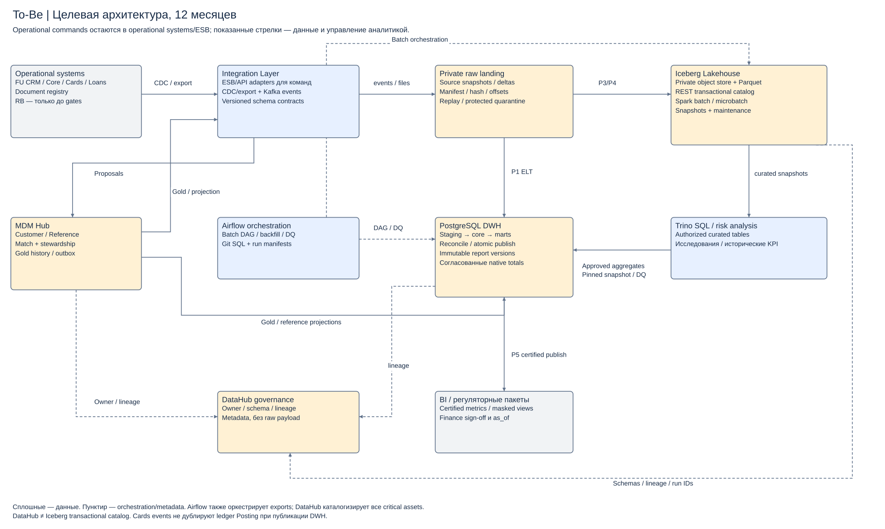

# To-Be: горизонт 12 месяцев

## Границы контуров

| Контур | Компоненты / ответственность | Почему выбран |
|---|---|---|
| Operational | FU CRM, Core, Cards, Loans; document registry; RB только пока не завершены gates портфеля | Команды, ACID, договоры и учёт остаются у профильных мастеров; изменение аналитики не требует переделывать весь банк |
| Master data | Customer/Reference Hub: PostgreSQL, matching/review API, crosswalk, approval, outbox | Единая идентичность и версии справочников; собственник золотой записи определён отдельно от физической БД |
| Integration | Существующий ESB/API adapters для команд; source CDC/snapshot connectors; Kafka для доменных событий; versioned schema registry | Убирает point-to-point аналитические связи; schema compatibility и replay по ключу. ESB не используется как массовый архив |
| Analytics ingestion | Isolated raw landing с manifests; Airflow batch DAG; SQL transforms в Git; DQ/quarantine | Исходный payload отделён от сертифицированной модели; checkpoint/версии позволяют воспроизвести расчёт |
| DWH | Отдельный PostgreSQL: staging → conformed core → marts → immutable report versions; read endpoint для BI | Контролируемая отчётность, финансовые сверки и закрытие периода. Нельзя отправить новый пакет до Finance sign-off |
| Lakehouse | Private S3-compatible object store, Parquet/Iceberg, transactional REST catalog, Spark batch, Trino SQL | История и события не раздувают операционные БД; compute масштабируется отдельно от storage. Каталог Iceberg хранит указатели/commit metadata, DataHub описывает business meaning |
| Serving | BI с certified metrics на DWH; Trino для разрешённых аналитических наборов; экспорт регулятору из закрытого DWH | Единые показатели и видимая свежесть; риск-аналитика не является online payment authorization |
| Governance | DataHub: схемы, owner/steward, классификация, lineage source→transform→table→dashboard; центральные access standards | Зависимости и ответственность доступны до изменения схемы; доступ проверяет реальная система хранения/API |

## Основные пути данных

Operational command проходит канал → API/ESB → единственный operational master; commit фиксирует локальную транзакцию и outbox/CDC. Аналитический consumer не вызывает обратный operational command. Hub получает proposals клиента, публикует утверждённые gold/crosswalk/reference updates в обе проекции и DWH.

Для финансового отчёта Core/Cards/Loans/CRM → CDC либо согласованная выгрузка → landing/manifest → DWH staging → as-of reference joins → проверки → сертифицированный mart → BI/report package. Исходная проводка принадлежит Core; карточная authorization используется для анализа поведения и не складывается повторно с ledger turnover.

История/канальные события → Kafka/архивы → raw object storage → Spark → Iceberg curated → Trino/risk analysis. В DWH из Lakehouse допускаются только согласованные агрегаты с pinned snapshot_id, batch_id, transform_version и отдельной сверкой. Финансовая проводка поступает в DWH один раз по основному ledger path, а не также из card events. Это предотвращает циклический double count.

Airflow планирует DAG, backfill и dependencies, но не передаёт каждое событие через scheduler. Streaming consumers работают отдельно; на выбранном объёме используем microbatch, а Flink оставляем для оценки при доказанной потребности в stateful low-latency processing. SQL transforms сначала хранятся и тестируются в Git; dbt можно добавить после оценки сложности DAG, он не является обязательным вторым оркестратором.

## Изоляция, доступность и эксплуатация

Нет BI-запросов к primary Core. Source export идёт из поддерживаемого журнала/read replica либо штатного extract с лимитом; лимиты проверяются на нагрузке, а не считаются нулевой нагрузкой по определению. Operational, integration, raw, curated и serving зоны имеют раздельные роли/сети/квоты. Никакие PAN/CVV/PIN не передаются в DWH/Lakehouse. Contacts/consents доступны по цели, raw text обращений — вне обычных витрин.

Kafka partitions выбираются после замеров по bank+entity+key; транзакционная целостность финансовой группы проверяется до publish по source transaction/control totals. Hub и DWH имеют HA/backup, failover и restore drills. RPO/RTO целей Task2 проверяются перед production; отсутствие замеров является ограничением решения. Отказ Lakehouse задерживает историческую аналитику, не блокируя Core и сертифицированный DWH; отказ DWH оставляет BI на последней версии с as_of, не фальсифицируя свежесть.

DataHub получает schema/lineage от connectors и ingestion jobs, версии SQL из Git и BI datasets; ручные внешние зависимости заносятся stewardship-процессом. Требование gate: у каждой критичной таблицы есть owner, sensitivity и upstream/downstream; автоматическое обнаружение не считается всеведущим. Совместимость схем проверяется в CI на sample synthetic events, breaking change получает новую major version и период двойного чтения, но не двух финансовых writers.

Выбор и отказ технологий собраны в [roadmap](../Task4/tech-roadmap.md), сопоставление механизмов — в [SOURCES](../SOURCES.md). Версии runtime-компонентов фиксируются после compatibility/security test; ссылка current в документации не означает автопереход на новую major в банке.
