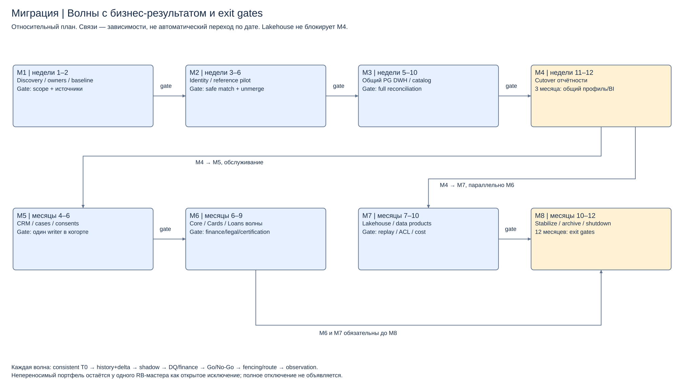

# Задание 4. Миграция и технологическая карта

Миграция выполняется восемью этапами с двумя результатами: совместная работа и отчётность к 3 месяцам, целевая платформа и выведение RB по проверенным когортам к 12. Календарная дата не заменяет gate финансовой/юридической приёмки.

[Образ результата](migration-target-state.md) · [Этапы](migration-plan.md) · [Cutover отчётности](cutover-plan.md) · [Риски](migration-risks.md) · [Технологии](tech-roadmap.md).

[Редактируемая схема](diagrams/migration-roadmap.drawio). Сроки относительные от старта программы; это план, не фактически выполненная миграция банка.
