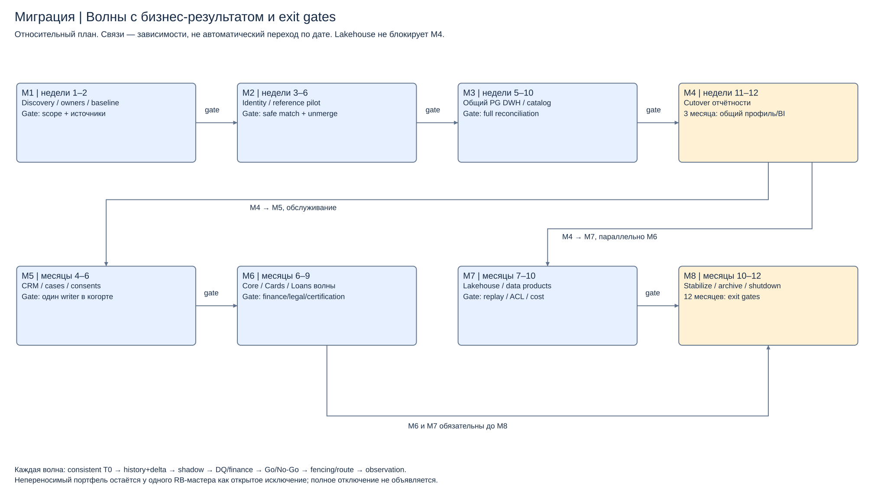

# Инкрементальный план: 8 этапов

Каждая волна даёт бизнес-результат и требует owner sign-off. Сроки — относительные месяцы от старта. Выполнение зависит от доступности source data, законности переноса и capacity; ресурсы команды должны быть подтверждены на discovery.

| Этап / срок | Действия и зависимости | Бизнес-результат / состояние мастеров | Gate / владелец |
|---|---|---|---|
| M1, недели 1–2: discovery | Инвентаризация систем/таблиц/consumers; glossary/BIAN; profiling дубликатов, контрольные суммы; legal/retention и CDC assessment | Известны источники и owner каждой критичной сущности; оба банка продолжают работу | Реестр, baseline totals, gaps, scope, утверждённые success criteria / Data Office+Finance+ИБ |
| M2, недели 3–6: identity pilot | После M1: Hub, crosswalk, reference mapping, conservative match; пилот одной согласованной когорты; steward queue и unmerge rehearsal | Общий ID без перевода финансовых мастеров; CRM proposals, Hub gold | Нет неразрешённых конфликтов auto merge, unique mapping, evidence/rollback / Customer Owner |
| M3, недели 5–10: общий DWH | После M1, согласованный mapping из M2: snapshot T0+delta; P1; независимые staging; минимальные customer/account/product/posting marts, catalog | Руководство видит обе организации; Core/Cards/Loans мастера по origin | Counts/sums/FK и D+1, lineage/access/load/restore gates / Finance+DWH |
| M4, недели 11–12: отчётный cutover | После M2/M3: 10 рабочих дней параллельных расчётов, [cutover](cutover-plan.md), переключение BI/report package, обучение | **Результат 3м**: единая отчётность, общий ID, DQ и план миграции; operational writers прежние | Finance Go/No-Go, фолбэк на реальном прогоне / Reporting Owner |
| M5, месяцы 4–6: CRM/обслуживание | После M4: RB обращения/consent evidence/doc refs в FU; user journeys, scoped routing по когорте и writer fencing; shared reference распространение | Один канал обслуживания, common profile, оперативные мастера счетов пока прежние | Открытые cases/consents/rights сверены, нет двух writers, жалобы/доступы проверены / Customer+Service owners |
| M6, месяцы 6–9: продуктовые волны | После M5 и отдельной подготовки Core/Cards/Loans: pilot→region/product cohorts. Initial load, delta, balance/interest reconciliation, epoch switch; миграция одной системы за раз | Для принятой когорты FU мастер; оставшийся RB портфель явный. Карты/кредиты могут иметь отдельную последовательность по зависимостям/сертификации | Нет необъяснённых расхождений, незавершённые инструкции закреплены, end-of-day/rollback rehearsal / Core+Cards+Loans owners |
| M7, месяцы 7–10: Lakehouse и products | После M4 параллельно M6: P3/P4 archive+events, Iceberg/Trino trial→production, four products, catalogue и ACL | История/канальная аналитика не нагружает OLTP/DWH | Performance/cost, no double count, replay/retention/restore/ACL / Platform+Risk+Channel |
| M8, месяцы 10–12: стабилизация и вывод | После всех доменных gates и M7: полные отчётные циклы, consumer sign-off, archive retrieval test, остановка старых jobs/runtime по акту | **Результат 12м**: целевые мастера и платформа, legacy выключен только по принятому охвату | Нет неизвестных consumers и активных legacy writers, retention/DR/финансовая приёмка; исключения остаются открыты / Programme Owner+Finance+IT |

## Шаблон переноса для каждой волны

**История и T0.** На источнике создаётся consistent snapshot и связанный с ним commit position; журнал изменений удерживается до финальной сверки. History export включает keys, source system, timestamps, deleted/tombstone и версии условий. Manifest включает count/hash/totals и охват. Если нет механизма согласованного snapshot+delta, используется штатное окно экспорта/реплика или волна блокируется — смешанный несогласованный снимок не считается корректным.

**Дельты и загрузка.** Source продолжает работу, delta events пишутся с T0; target загружается в shadow. Строки snapshot и delta сходятся по source key/version. Удаления/закрытия обрабатываются явно, не теряются из-за updated_at polling. Неполная транзакционная группа или отсутствующий родитель удерживает затронутую часть в quarantine. Replays не исполняют платежи повторно.

**Сверка.** Техническая: files/hash/count/key/FK/version ranges. Бизнес: customer mappings и роли, счётные остатки opening+movement=closing в исходной валюте, debit/credit controls, статусы платежей, проценты/графики, тарифы/согласия/документы. Gate — ноль необъяснённых финансовых differences, approved reconciliation report с параметрами/водяными знаками.

**Маршрут и writer.** Mapping registry хранит cohort/master/epoch/effective_at. Сначала drain in-flight команд, затем fencing старого writer в узком доменном охвате; новые команды буферизуются с idempotency key либо обслуживаются существующим источником до назначенного commit barrier. Клиентский read/остальные портфели работают. При переключении доказана принадлежность каждого accepted command ровно одному executor. Окно/UX/таймауты и capacity очереди должны пройти отдельный load rehearsal. Нельзя обещать нулевую задержку без замеров.

**Фолбэк.** До первых новых финансовых commits в FU можно вернуть маршрут прежнему мастеру после снятия fencing. После нового финансового commit простой возврат маршрута запрещён: сначала согласованный reverse delta/correction и полная сверка. Если обратная синхронизация не сертифицирована, применяется forward repair с ограничением новых изменений в данной когорте; остальные сервисы продолжают работу. Точка необратимости и допустимый ремонт фиксируются для каждого домена до Go.

**Вывод.** Legacy сначала read-only, затем период наблюдения не меньше полного согласованного отчётного/расчётного цикла и сверки внешних потребителей. Только затем отключение runtime и jobs, безопасный archive/backup lifecycle и закрытие доступа. Calendar milestone сам по себе не даёт разрешения пропустить gate.
